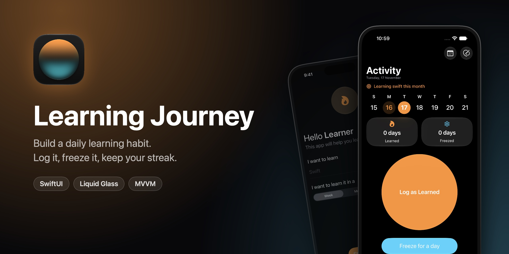
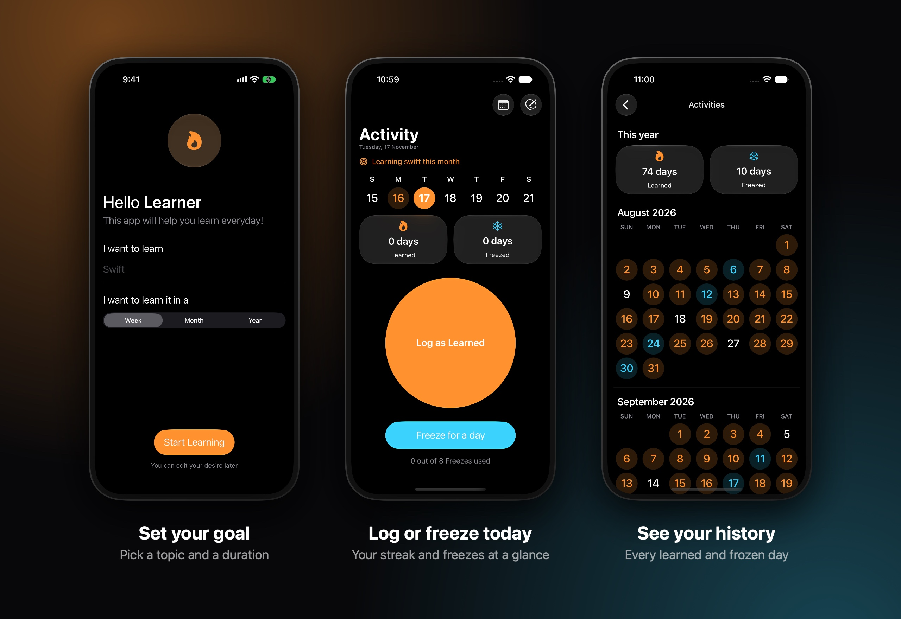

  

## Learning Journey 🔥

Learning Journey helps you build a daily learning habit. Set what you want to learn and for how long, then log each day as learned — or freeze it when you need a break — and watch your streak grow.

## Features

- **Set a learning goal** — choose a subject and a duration (week, month, or year).
- **Log your day** — mark today as *Learned* with one tap.
- **Freeze a day** — take a break without losing your streak (2 freezes per week, 8 per month, 96 per year).
- **Change your mind** — switch today between *Learned* and *Frozen* at any time.
- **Track your week** — see each day's status at a glance: orange for learned, blue for frozen.
- **Change your goal anytime** — with a confirmation, since your streak starts over from today.
- **Calendar history** — browse every month you've logged, plus this year's total of learned and frozen days.
- **Goal results** — see whether you completed your goal when the period ends, and set a new one.
- **Light & Dark mode** — follows your system appearance.

## Screenshots

  

## Technologies

- **Swift & SwiftUI**
- **Liquid Glass** — native glass buttons, toolbar, and cards
- **MVVM** — a ViewModel for each screen, with Views that only display
- **Observation** (`@Observable`) for state
- **UserDefaults** to save your goal and history on the device
